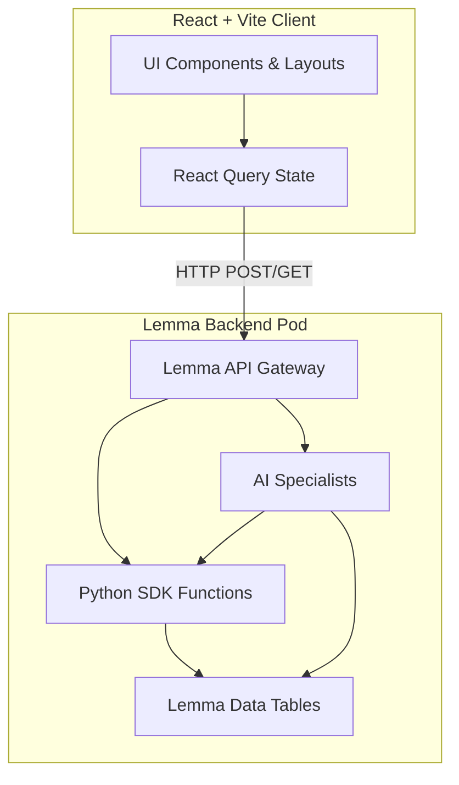

<div align="center">
  
  # 🔮 AI Alchemist
  **The AI-Native Career Operating System**
  
  [](https://ai-alchemist.apps.lemma.work)
  [](https://react.dev)
  [](https://tailwindcss.com)
  [](https://vitejs.dev)
  
  <br />
</div>

## 🚀 Overview

Job hunting in the modern era is fragmented and chaotic. Candidates manage resumes in Word, track applications in Excel spreadsheets, prepare for interviews blindly, and guess at their ATS compatibility.

**AI Alchemist** is an all-in-one AI orchestration platform designed to replace that chaos. Powered by the Lemma SDK, it provides a fleet of specialized AI agents that act as your personal career board: matching jobs, optimizing resumes, tracking pipelines, and coaching you through live interview simulations.

---

## ✨ Premium Features

- 🧠 **AI Mission Control:** Chat directly with multiple AI Specialists in a unified workspace. Watch their execution in real-time through the Execution Inspector.
- 📄 **Resume Intelligence Studio:** Upload your resume for live ATS optimization scoring, keyword extraction, and gap analysis.
- 🎯 **Job Matching Engine:** Paste any job link to instantly calculate a compatibility score, identify missing skills, and generate tailored applications.
- 🎙️ **Interactive Interview Lab:** Practice with a streaming, interactive technical interview simulator that adapts to your target role.
- 📊 **Career Pipeline:** A beautifully animated Kanban board for tracking applications from 'Saved' to 'Offer'.
- 🚀 **Judge Mode / Demo State:** Instantly boot the app with 1-click rich mock data for rapid evaluation without needing a backend token.

---

## 🏗️ System Architecture

AI Alchemist is built on a modern, decoupled architecture featuring a lightning-fast React frontend and an agentic backend powered by Lemma.



---

## 💻 Tech Stack

### Frontend Ecosystem
- **Framework:** React 19 + Vite
- **Routing:** TanStack Router (File-based)
- **Styling:** TailwindCSS + Framer Motion for liquid animations
- **Components:** shadcn/ui + Radix Primitives + Lucide Icons
- **State & Data:** React Query, Axios

### Backend Intelligence
- **Platform:** Lemma SDK Pod
- **Data Layer:** Lemma Managed Tables
- **Logic:** Agentic Workflows & Python Functions

---

## 🛠️ Installation & Setup

Want to run AI Alchemist locally? Follow these steps to get started.

### 1. Prerequisites
- Node.js (v18 or higher)
- npm or yarn

### 2. Clone the Repository
```bash
git clone https://github.com/MusthabaSM/AI-Job_Command-Centre.git
cd AI-Job_Command-Centre
```

### 3. Install Dependencies
```bash
npm install
```

### 4. Environment Variables
Create a `.env` file in the root directory and add your Lemma API credentials if you intend to run the full backend:
```env
VITE_LEMMA_API_URL=your_lemma_api_url
VITE_LEMMA_API_TOKEN=your_lemma_api_token
```
*(Note: You can skip this step if you just want to run the frontend in **Judge Mode**, which uses beautiful mock data.)*

### 5. Start the Development Server
```bash
npm run dev
```
The application will be available at `http://localhost:5173`.

---

## 🌐 Live Website

Experience the future of career management live:
**👉 [https://ai-alchemist.apps.lemma.work](https://ai-alchemist.apps.lemma.work)**

---

<div align="center">
  <p>Built with ❤️ for the AI SaaS Hackathon 2026.</p>
</div>
